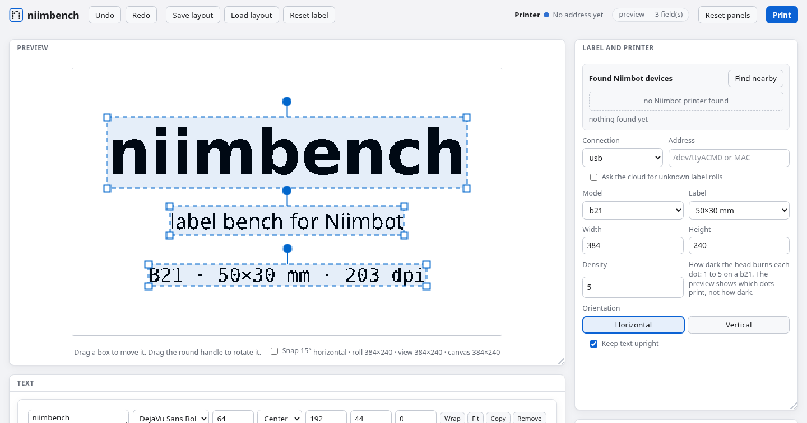

<p align="center">
  <picture>
    <source media="(prefers-color-scheme: dark)" srcset="docs/assets/logo-dark.svg">
    
  </picture>
</p>

<p align="center">
  <em>Lay out a label in your browser, see the exact dots the print head will burn,
  and print it on a Niimbot printer over USB or Bluetooth.</em>
</p>

<p align="center">
  <a href="https://github.com/ywy50/niimbench/actions/workflows/ci.yml"></a>
  <a href="https://github.com/ywy50/niimbench/releases/latest"></a>
  
  
  
  <a href="LICENSE"></a>
</p>

niimbench designs and prints labels on Niimbot label printers, the D110, D11, B21, B1 and B18, from Linux or a Raspberry Pi, over USB or Bluetooth, with no phone app or account. It is one static binary written in Zig, and it is inspired by [niimprint](https://github.com/AndBondStyle/niimprint).

## Quick start

Run the latest release on a 64-bit x86 Linux machine, with nothing to install:

```bash
curl -fsSL https://github.com/ywy50/niimbench/releases/latest/download/niimbench-x86_64-linux.tar.gz | tar xz
./niimbench-x86_64-linux/niimbench
```

On a 64-bit ARM machine, such as a Raspberry Pi 4 or 5 running a 64-bit OS:

```bash
curl -fsSL https://github.com/ywy50/niimbench/releases/latest/download/niimbench-aarch64-linux.tar.gz | tar xz
./niimbench-aarch64-linux/niimbench
```

On Windows, run the x86_64 build inside WSL 2 and open the address it prints in your Windows browser. What works there, and macOS, are under [Windows and macOS](#windows-and-macos).

From source you need Zig 0.17. Node and a Chromium-family browser are only needed for `make test`.

Serve the editor and open it in your browser:

```bash
make
```

Run every check:

```bash
make test
```

Print a binary PGM over USB:

```bash
make print IMAGE=label.pgm ADDR=/dev/ttyACM0
```

Print the same file over Bluetooth:

```bash
make print IMAGE=label.pgm ADDR=AA:BB:CC:DD:EE:FF CONN=bluetooth
```

Everything below is detail.

## What it is

<p align="center">
  
</p>

One process serves the editor page on `127.0.0.1`, renders labels, and prints them over USB serial or Bluetooth Low Energy through BlueZ. The browser is a client of that server, and so is anything else that calls its HTTP API.

- **What you see is what prints.** The preview is the grayscale the printer will get: preview and print share one drawing path on the server.
- **It finds the printer.** A scan of the serial ports and of BlueZ fills in the connection, the address and the model, and the roll the printer reports.
- **Text in real fonts.** Fifteen free fonts are embedded and drawn by niimbench's own TrueType rasteriser, so a print never depends on what is installed.
- **Pictures in one ink.** An imported picture is reduced to black and white at a threshold you choose, then moved, scaled and turned on the label.
- **A board, not a form.** Preview, printer, text and image are panels you drag by their titles and resize from a corner. This browser remembers where you put them.
- **Checked by driving it.** `make test` drives the page in a headless browser, and no server a test starts can outlive the run.

The process is a plugin tree in the sense of [Cordis](https://deepseek-harness.github.io/deepseek-harness/reference/cordis-primer) ([arXiv:2608.25512](https://arxiv.org/abs/2608.25512)): every feature is mounted on a context, names what it needs, and removes its registrations on unload. The docs layout follows [DeepSeek Harness](https://github.com/deepseek-ai/deepseek-harness).

The documentation index is [docs/README.md](docs/README.md).

## Running it

`make` listens on `127.0.0.1` with an ephemeral port, prints a URL that carries the session token, and opens it with `xdg-open`. `make serve` leaves the URL for a browser you already have. `PORT=8080` picks the port. `make help` lists the targets and variables.

`label.pgm` is a binary P5 file: `P5`, width, height, maxval `255`, then one byte per pixel. `0` is black and `255` is white.

The editor guide is [docs/user/guide/index.md](docs/user/guide/index.md). A layout you can load is [docs/templates/example-label.json](docs/templates/example-label.json).

## Editor

The page places text fields and previews the bitmap the printer will get. Preview and print both go through `POST /api/render` and `POST /api/print`, which share one drawing path on the server.

Each field has its own font, a size in dots, an alignment, a position and an angle. Drag a field's box to move it, drag a corner to resize it, and drag the round handle to turn it. Text that would run off the label is marked clipped. Save layout writes JSON; Load layout reads it back. The saved file leaves out the background image.

The editor draws literal text. The HTTP routes also take a JSON `source` and a field `key` to fill a field from, and sources can be added and removed while the process runs: [docs/subsystems/sources.md](docs/subsystems/sources.md).

## Printers

| Model | Print head | Density |
|---|---|---|
| B1 | 384 dots | 1 to 5 |
| B18 | 384 dots | 1 to 3 |
| B21 | 384 dots | 1 to 5 |
| D11 | 96 dots | 1 to 3 |
| D110 | 96 dots | 1 to 3 |

B18, D11, and D110 densities above 3 are clamped to 3. Head width, density, and the raster live in [docs/subsystems/printer.md](docs/subsystems/printer.md).

The editor scans for printers and lists what it finds under **Found Niimbot devices**. Picking one fills in the connection, the address, and the model, so the label is built for the printer that is there. The scan probes the serial ports and asks BlueZ what Bluetooth devices exist; **Find nearby** adds an inquiry. The subsystem page is [docs/subsystems/printer.md](docs/subsystems/printer.md#discovery).

| Connection | What it needs |
|---|---|
| USB | A user who can open the tty: `dialout` on most Linux machines |
| Bluetooth | BlueZ on the system bus, so a running `bluetoothd`. A BLE printer is written over its print characteristic |

## Fonts

Text is drawn by niimbench's own TrueType rasteriser from fonts embedded in the binary, so a print never depends on what is installed. Fifteen free fonts ship with it:

| Family | Faces |
|---|---|
| Fira Sans | Book, Bold |
| DejaVu | Sans, Sans Bold, Sans Mono, Serif |
| Liberation | Sans, Sans Bold, Serif, Mono |
| Open Sans | Regular, Bold |
| Noto | Sans, Serif |
| Hack | Regular, monospaced |

Their licences and origins are in [src/fonts/README.md](src/fonts/README.md), and how text is drawn is [docs/subsystems/text.md](docs/subsystems/text.md).

## Layout

| Path | What it is |
|---|---|
| `src/cordis.zig` | Context, inject, reversible effects |
| `src/packet.zig`, `src/printer.zig`, `src/raster.zig` | Printer core |
| `src/label.zig` | Text layout: font, size, alignment, turning, clipping |
| `src/font.zig`, `src/fonts/` | TrueType reader and rasteriser, and the embedded fonts with their licences |
| `src/device.zig` | The USB serial and Bluetooth openers, and the two finders |
| `src/ble.zig`, `src/dbus.zig` | The BLE print channel, and the BlueZ D-Bus client it uses |
| `src/discovery.zig` | Found-device list and model lookup |
| `src/server.zig`, `src/editor.html` | HTTP API and the editor page |
| `src/plugins.zig`, `src/example_source.zig`, `cordis.patch.yml` | Boot list and plugins |
| `tools/` | The browser and node checks `make test` runs, the page lint, the throwaway-server and browser-driving harness, and the label catalogue fetcher |
| `docs/assets/` | The logo kit, and the README's screenshot with the steps that take it ([docs/assets/README.md](docs/assets/README.md)) |
| `Makefile` | `make`, `make serve`, `make test`, `make drive`, `make print`, `make labels` |
| `.github/workflows/` | CI on every push and pull request, and the tag-driven release |
| `CHANGELOG.md` | What each release changed |
| `docs/` | Index, architecture, subsystems, cookbook, user guide, templates, reviews |

## Windows and macOS

niimbench runs on Linux for now. It reaches printers through Linux's own interfaces: BlueZ for Bluetooth, and the kernel's serial ports for USB.

On Windows, the Linux build runs inside WSL 2. Start it there and open the address it prints in your Windows browser, which WSL forwards to it. A printer on USB, such as the B21, is reached once [usbipd-win](https://github.com/dorssel/usbipd-win) attaches it to WSL, where it shows up as `/dev/ttyACM0`. Bluetooth is not available inside WSL, so a Bluetooth-only printer such as the D110 cannot print from there.

There is no macOS build yet.

## Releases

Each release on the [releases page](https://github.com/ywy50/niimbench/releases) has a tarball for x86_64 and one for arm64 Linux. Each holds a static `niimbench` binary, which needs no libc or other library, with `LICENSE`, this README, `CHANGELOG.md`, and the licences of the fonts compiled into the binary. Every tarball comes with a `.sha256` and a build provenance attestation signed by the release workflow.

Check a download before you run it:

```bash
sha256sum -c niimbench-x86_64-linux.tar.gz.sha256
gh attestation verify niimbench-x86_64-linux.tar.gz --repo ywy50/niimbench
```

`niimbench --version` prints the version, and [CHANGELOG.md](CHANGELOG.md) says what each one changed. Cutting a release is [docs/cookbook/releasing.md](docs/cookbook/releasing.md).

## Contributing

See [CONTRIBUTING.md](CONTRIBUTING.md). Agents follow [AGENTS.md](AGENTS.md).

## Development

Start with [docs/development.md](docs/development.md) and [docs/architecture.md](docs/architecture.md).

## License

niimbench is [MIT](LICENSE). The embedded fonts keep their own licences, listed in [src/fonts/README.md](src/fonts/README.md).
